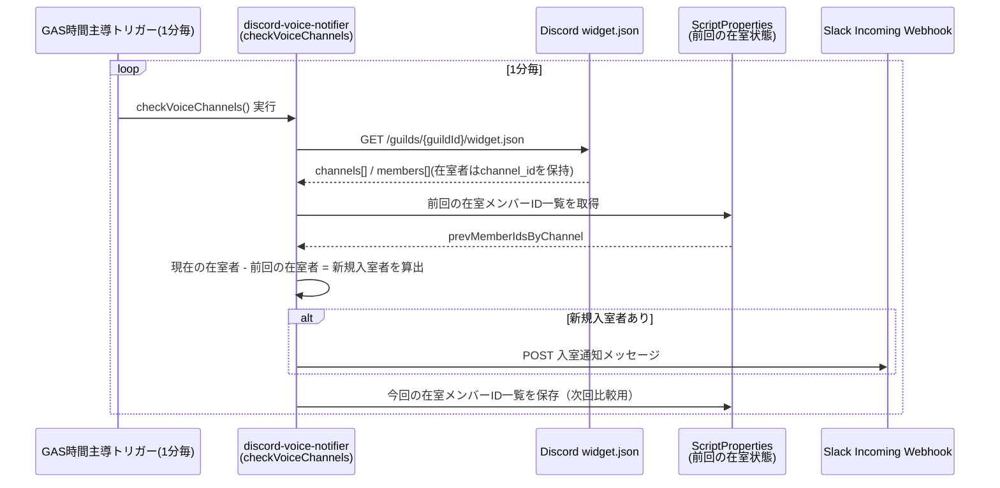

# Discordボイスチャンネル入室通知 - 調査まとめ

## 背景・要件

Discordのボイスチャンネルへの入室を検知し、Slackへ通知したい。Bot開発（常時稼働サーバーの運用）はせず、既存の `slack-gas-event-manager` と同じくGAS（Google Apps Script）だけで完結させる。GASプロジェクトは既存のイベント管理システムとは独立させ、`discord-voice-notifier/` に分離する。

## 検討した検知方式

Discordはボイス状態の変化を外部へpushするWebhookを提供していない。受け取るには常時接続のGateway（WebSocket）を張るBotが必須だが、GASはリクエスト駆動の実行環境でGatewayを維持できない。

| 方式 | Bot開発 | GASのみで完結 | リアルタイム性 |
|---|---|---|---|
| Gatewayベースの外部Bot → GASへwebhook | 必要 | 不可（別サーバー要） | 高い |
| **サーバーウィジェット(widget.json)のポーリング（採用）** | 不要 | 可能 | 最大1分遅延 |

Discordの「Webhook」は受信専用（外部→Discordへの投稿）であり、Discord側からのイベントpushには使えない。サーバー設定の「Engagement」内で有効化できる**ウィジェット**は、認証不要の公開JSONエンドポイントを提供しており、これをGASの時間主導トリガーで定期ポーリングする方式を採用した。

## 採用方式: widget.json ポーリング



### 制約・注意点

- `widget.json` の `member.id` はDiscordが匿名化した値で実際のユーザーIDではない（プライバシー保護の仕様）。在室差分の検知にのみ使用可能で、メンションやDM送信など実ユーザーの特定が必要な用途には使えない。
- 非公開・権限制限されたボイスチャンネルの在室者はウィジェットに出ない（`@everyone`が閲覧できないチャンネルは対象外）。
- ポーリング間隔はGASの時間主導トリガーの制約で最短1分。通知には最大1分程度の遅延が生じる。
- 事前に対象Discordサーバーの「サーバー設定 > Engagement」でウィジェットを有効化しておく必要がある。

## レート制限の調査結果

一次情報（Discord公式ドキュメント）ベース。

- **グローバル制限**: 認可ヘッダーなし（widget.jsonのような未認証リクエスト）の場合、IPアドレスあたり**50リクエスト/秒**。
- **ルート単位の制限**: パス中のトップレベルリソース（`guild_id`など）ごとに独立して計算される。widget.jsonの具体的な数値は非公開だが、他サーバーへのポーリングとは制限が混ざらない。
- **429時の挙動**: HTTP 429 + `retry_after`（JSON）と`Retry-After`ヘッダーが返る。即座にリトライせず、指定秒数待つのが推奨。
- **無効リクエストのIPスロットル**: 401/403/429などの「無効なリクエスト」が**10分間に10,000回**に達すると、そのIPがDiscord API全体から一時的にブロックされる。429を無視して即リトライを繰り返すと抵触しうる。

**結論**: 本実装の頻度（1分1回＝1,440回/日）は上記いずれの上限にも遠く及ばず、通常運用でDiscord側の上限に当たる可能性は低い。GASのUrlFetchAppはGoogle側の共有IPから発信されるため、自分の呼び出し頻度と無関係に他スクリプトの影響で稀に429が発生し得るが、実装では429を`RATE_LIMITED`として区別し、致命的エラーにせず次回ポーリング（1分後）に委ねている（`DiscordWidget.gs` / `Main.gs`）。

参考:
- [Rate Limits - Documentation - Discord](https://docs.discord.com/developers/topics/rate-limits)
- [Discord API Rate Limiting: A Troubleshooting Guide · Stateful](https://stateful.com/blog/discord-rate-limiting)

## セキュリティ上のメリット・デメリットと対策

ウィジェットの `widget.json` は**認証なしで誰でも取得可能**な公開エンドポイントであるため、Bot不要という利便性とトレードオフでいくつかの露出リスクがある。

| 項目 | 内容 |
|---|---|
| メリット | Bot不要・GASのみで完結、外部サイトへの埋め込み表示も可能 |
| デメリット | Guild IDが分かれば、サーバーメンバーでない第三者でも在室状況を外部から取得できる |
| 対策1 | 「招待チャンネル」は設定しない → widget経由での無断参加リンク公開を防ぐ |
| 対策2 | 通知対象外のボイスチャンネルは `@everyone` の閲覧権限を外す → widget.jsonにも出なくなる |
| 対策3 | Guild IDは非公開情報として扱う（スクリプトプロパティのみで保持し、コード・READMEにコミットしない） |
| 構造的な限界 | ロール/トークンによるアクセス制限は仕様上不可能。厳密な非公開が必須要件になった場合はGatewayベースの外部Botへ方式転換が必要 |

なお、表示されるのは `@everyone` ロールが閲覧権限を持つチャンネルのみのため、権限で隠したプライベートチャンネルの情報が漏れることはない。

## 実装構成

```
discord-voice-notifier/
├── .clasp.json          # gitignore対象。scriptIdを保持
└── src/
    ├── appsscript.json  # V8ランタイム・Asia/Tokyo・必要スコープのみ
    ├── Config.gs        # DISCORD_GUILD_ID / SLACK_WEBHOOK_URL をスクリプトプロパティから読込
    ├── DiscordWidget.gs # widget.json取得。429はRATE_LIMITEDとして区別
    ├── Main.gs          # checkVoiceChannels()（1分毎トリガー）/ setupTriggers()
    └── SlackNotifier.gs # Slack Incoming Webhookへの投稿
```

- 新規Apps Scriptプロジェクトを作成し、`clasp push` 済み。
- 既存プロジェクトの `.github/workflows/deploy.yml`（GitHub Actions）はこのプロジェクトを対象にしていない。CI連携は未整備。

## セットアップ手順（残タスク）

1. Discordサーバー設定 > Engagement でウィジェットを有効化（招待チャンネルは未設定のまま維持）
2. 通知対象外のボイスチャンネルは `@everyone` の閲覧権限を外す
3. Slackで Incoming Webhook を作成し、URLを控える
4. GASエディタのスクリプトプロパティに `DISCORD_GUILD_ID` / `SLACK_WEBHOOK_URL` を登録
5. `setupTriggers()` をGASエディタから手動実行
